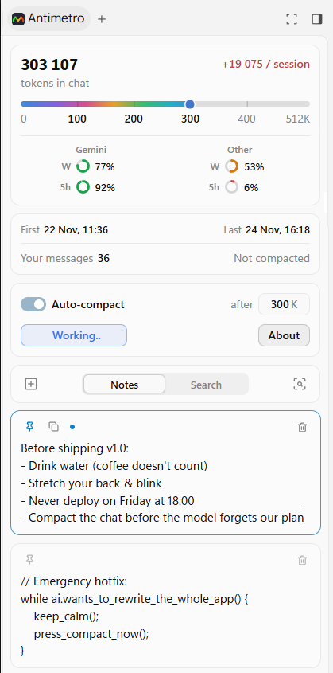
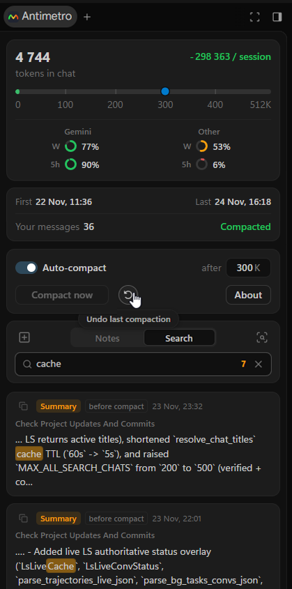

#  Antimetro

**Live token meter, model quota rings, smart auto-compact, per-chat notes, and instant search for Antigravity App 2.0.**

Tested on **Antigravity App 2.0 (v2.35.2)** · Pure **Rust** (`0` external crates, ~690 KB) · By **[izomondo](https://izomondo.com)**

<table>
  <tr>
    <td align="center" valign="top" width="50%">
      
       
      <b>Light theme:</b> Live tokens, model quota rings, draggable auto-compact pin, and <b>Notes</b>
    </td>
    <td align="center" valign="top" width="50%">
      
       
      <b>Dark theme:</b> Instant compaction with 1-click <b>Undo</b> and global <b>Search</b> across chats, archive &amp; notes
    </td>
  </tr>
</table>

---

## Why Antimetro?

Antigravity 2.0 waits until a chat hits **512,000 tokens** before compacting automatically, and hides your live context size while you work.

Once a chat passes **150K–200K tokens**:
1. **Model quality fades** — older instructions and project details start slipping out of focus.
2. **Quota burns faster** — every tool call re-sends a massive history.
3. **Replies slow down.**

**Antimetro** sits quietly in the Side Panel so you always see what is happening and stay in control.

---

## What it does

- **Live context meter & session delta** — shows exact tokens in the current chat (`0–512K` scale with calm color zones) and how much the session grew or shrank (`+19 075 / session` or `-298 363 / session` right after compaction).
- **Model quota rings at a glance** — displays your **Gemini** and **Other** (Claude/GPT) weekly (`W`) and 5-hour (`5h`) limits right under the meter, with color-coded progress rings and `Resets in ...` tooltips, updating live during active turns.
- **1-click Compact & safe Undo** — compact anytime with **Compact now**, or revert an accidental compaction in one click with **Undo** without touching your files.
- **Smart Auto-compact** — toggle **Auto-compact** and drag the blue threshold pin right on the meter (`10K–500K`). Remembered per chat and always waits until the model finishes its turn.
- **Per-chat Notes** — fast card-based notes with automatic saving, **Pin to top**, clean 5-line collapse when you click away, and automatic cleanup when you delete a chat in Antigravity.
- **Instant Search (`Ctrl+F` / `Cmd+F`)** — search across up to 500 recent chats (including archived chats), your notes, and older messages hidden after compaction (`before compact`). Click any chat title in the results (`↗`) to jump straight into that conversation, or narrow search to the current chat with one click.
- **Native feel, 100% local** — automatically matches your Antigravity light/dark theme and accent color. The Rust sidecar runs strictly on `127.0.0.1` with zero telemetry and zero external dependencies (the panel checks GitHub Releases once every 24 hours to notify you of new versions, sending zero user data).

> **Good to know:** If you switch model families mid-chat (or after a prompt-cache expiry), tokenizers recount the history slightly differently, so `/ session` may briefly jump or dip on that turn before returning to normal.

---

## Easy Installation (No Rust Required)

1. Download the archive for your OS from **[Releases](https://github.com/izomondo/antimetro/releases)**:
   - **Windows (x64):** `Antimetro-Windows-x64.zip`
   - **macOS (Apple Silicon M1–M4):** `Antimetro-macOS-arm64.zip`
   - **macOS (Intel):** `Antimetro-macOS-x64.zip`
   - **Linux (x64):** `Antimetro-Linux-x64.tar.gz`
2. Unpack and run the installer:
   - **Windows:** Double-click **`Install.bat`** (if Windows SmartScreen asks, click *More info → Run anyway* — release binaries are unsigned and built publicly via GitHub Actions).
   - **macOS:** Double-click **`Install.command`** (if macOS asks, allow it in *System Settings → Privacy & Security*).
   - **Linux:** Run `./install.sh`.
3. **First-time install:** Fully restart Antigravity (including the tray icon) and open **Antimetro** in the Side Panel.

**Updating:** Download the latest archive and run `Install.bat`, `Install.command`, or `./install.sh` right over your existing installation — Antigravity reloads the new binary automatically, and all your notes and per-chat settings stay intact.

*(To uninstall anytime, run `Uninstall.bat`, `Uninstall.command`, or `./uninstall.sh`.)*

---

## Build from Source

If you have Rust (`cargo`) installed:

- **Windows:** `powershell -ExecutionPolicy Bypass -File .\install.ps1`
- **macOS & Linux:** `chmod +x ./install.sh && ./install.sh`

Then fully restart Antigravity.

---

## Support & Feedback

Feedback, ideas, and bug reports are very welcome! If something feels off or you have an idea that would make Antimetro more useful in your daily workflow, please open an issue — every single one is read personally.

- **Feedback, Bug Reports & Ideas:** **[GitHub Issues](https://github.com/izomondo/antimetro/issues)**
- **Support & Donations:** **[izomondo.com/support](https://izomondo.com/support)**

Antimetro is built and maintained as a solo-authored project by **izomondo** to keep the codebase tiny, zero-dependency, and cohesive. External pull requests are not accepted — please share your ideas or bug reports in Issues instead.

---

## License & Trademarks

- **Code:** **[Apache License, Version 2.0](LICENSE)**
- **Trademarks:** `"Antimetro"`, `"izomondo"`, and the Antimetro logo are trademarks of **izomondo** ([NOTICE](NOTICE)). Modified versions or forks may not use these names or logos.
