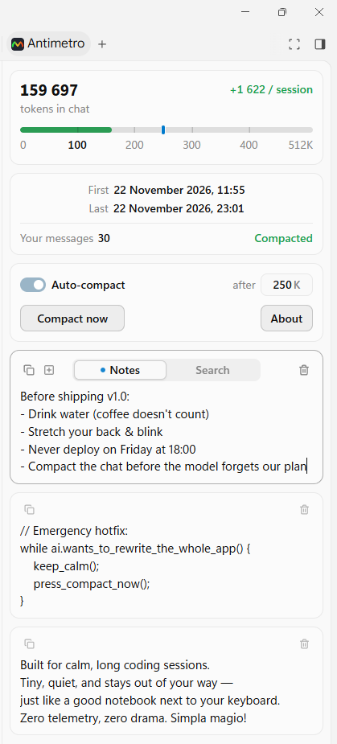
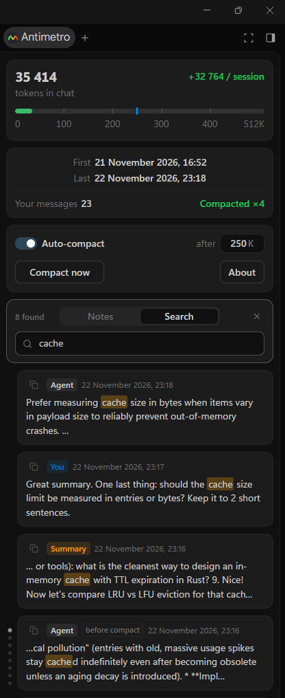
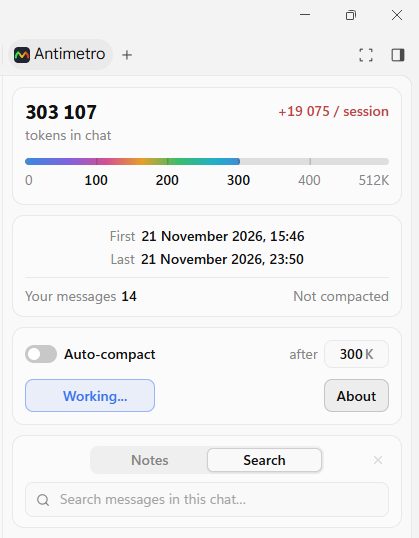
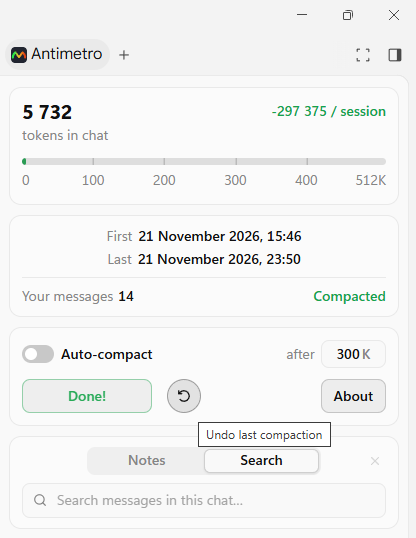

#  Antimetro

**Live context token meter, smart auto-compact, per-chat notes, and full transcript search for Antigravity App 2.0.**

Tested on **Antigravity App 2.0 (v2.34.0)** · Built with pure **Rust** (`0` external crates, ~551 KB binary) · By **[izomondo](https://izomondo.com)**

<table>
  <tr>
    <td align="center" valign="top" width="50%">
      
      <br />
      <sub><b>Light theme:</b> Live token meter, Auto-compact (250K), and per-chat <b>Notes</b> cards</sub>
    </td>
    <td align="center" valign="top" width="50%">
      
      <br />
      <sub><b>Dark theme:</b> Instant <b>Search</b> across <code>You</code>, <code>Agent</code>, <code>Summary</code>, and <code>before compact</code> history</sub>
    </td>
  </tr>
</table>

---

## Why Antimetro?

By default, Antigravity 2.0 waits until a chat reaches **512,000 tokens** before compacting the context window, and does not show the live token count while you work.

When a chat grows past **150K–200K tokens**:
1. **Model quality drops** (*Lost in the Middle* effect — the model starts forgetting instructions and project details).
2. **Quota burns much faster** because every single tool call re-sends hundreds of thousands of tokens.
3. **Responses slow down.**

**Antimetro** sits cleanly in the Antigravity Side Panel and gives you full visibility and control:
- **Exact live token count** (`cache_read_tokens + input_tokens` read directly from the local conversation transcript, excluding `/compact` commands from `Your messages`).
- **Full-session token delta** (`+20 345 / session` from the very first reply across all tool calls and background tasks, switching cleanly to `-N / session` right after compaction to show freed tokens) plus an animated progress-bar flow while the model is busy.
- **1-click manual compaction & safe Undo** (`Compact now` button with centered `Working...` -> `Done!` status, active-turn and post-compaction lock to prevent accidental double-compaction until your next message, plus a round Undo button right next to `Compact now` — playing Antigravity's native completion sound according to your app sound settings — until your next message so you can revert an accidental compaction without touching any code files).
- **Per-chat smart Auto-compact** (`Auto-compact after [ 250 ] K` — remembered individually for each chat, even after archiving, and triggers 1 second after the model finishes its reply).
- **Per-chat `Notes` & Pinned Cards** — expands up to `1000px` and fills the remaining panel height with Zed-style auto-save (`1.5s` delay + instant flush on focus loss or chat switch), 1-click `+` (or `Ctrl+Enter` / `Cmd+Enter`) to save the current note as a standalone 5-line card below, **Pin** with smooth animated reordering to anchor key cards at the top of the list, subtle bottom-edge fade for longer cards, smooth click-to-expand editing with auto-collapse on outside click, left dot-rail navigation on overflow, and safe two-step delete confirmation (`Check` / `X`). Works right away even in a brand-new empty chat before your first message, seamlessly carrying over your draft notes, cards, and Auto-compact settings once the chat starts.
- **`Search` (`This` / `All` chats)** — press `Ctrl+F` (`Cmd+F`) anytime to search across the active conversation or all recent local chats (up to `200` transcripts with conversation titles and active-chat markers), covering `You`, `Agent`, and past compaction summaries—including older messages hidden after `/compact` (`before compact`). Supports multi-word out-of-order matching with exact-phrase & proximity ranking, `"quoted"` exact phrases, best-window snippets with highlighted terms, smooth click-to-expand full message view, and 1-click full message copy.
- **Native theme, accent & UI polish** — automatically matches your Antigravity theme and `Appearance -> Accent` color, complete with Antigravity-style pill tooltips, context menus, and auto-hiding scrollbars.
- **100% local & private** — zero network requests outside `127.0.0.1`, zero telemetry, zero external dependencies.

### Live Compaction & Safe Undo

<table>
  <tr>
    <td align="center" valign="top" width="50%">
      
      <br />
      <sub><b>Compacting at 303K:</b> animated activity bar and active-turn lock</sub>
    </td>
    <td align="center" valign="top" width="50%">
      
      <br />
      <sub><b>297K tokens freed:</b> instant confirmation and 1-click <b>Undo</b></sub>
    </td>
  </tr>
</table>

### Good to know
- **Switching models & `/ session`:** Different model families use different tokenizers, system prompt wrappers, and caches. When you switch models mid-chat (or when Antigravity rebuilds the conversation history after a prompt-cache expiry), the same history can be recounted slightly smaller or larger—so `/ session` may briefly show a negative number or a sudden jump on that transition turn before resuming normally on your next prompt.

---

## Easy Installation (No Rust Required)

1. Go to the **[Releases](https://github.com/izomondo/antimetro/releases)** page and download the archive for your system:
   - **Windows (x64):** `Antimetro-Windows-x64.zip`
   - **macOS (Apple Silicon M1–M4):** `Antimetro-macOS-arm64.zip`
   - **macOS (Intel):** `Antimetro-macOS-x64.zip`
   - **Linux (x64):** `Antimetro-Linux-x64.tar.gz`
2. Unpack the archive:
   - **Windows:** Double-click **`Install.bat`**.
   - **macOS:** Double-click **`Install.command`** (if macOS asks for confirmation, allow it in *System Settings → Privacy & Security*).
   - **Linux:** Run `./install.sh`.
3. **Fully restart Antigravity** (including the system tray icon) and open **Antimetro** in the Side Panel.

*(To remove the plugin at any time, double-click `Uninstall.bat` on Windows, `Uninstall.command` on macOS, or run `./uninstall.sh` on Linux).*

---

## Build from Source (For Developers)

If you have the Rust toolchain (`cargo`) installed and prefer to compile from source:

### Windows (PowerShell)
```powershell
powershell -ExecutionPolicy Bypass -File .\install.ps1
```

### macOS & Linux
```bash
chmod +x ./install.sh
./install.sh
```

Then fully restart Antigravity.

---

## Support & Feedback

- **Support & Donations:** **[izomondo.com/support](https://izomondo.com/support)**
- **Bug Reports & Ideas:** Open an issue in **[GitHub Issues](https://github.com/izomondo/antimetro/issues)**

### Pull Request Policy

Antimetro is maintained as a solo-authored project by **izomondo** to keep the codebase minimal, zero-dependency, and legally clean. **External pull requests are not accepted.** If you find a bug or have a feature idea, please open an Issue instead.

---

## License & Trademarks

- **Source Code:** Licensed under the **[Apache License, Version 2.0](LICENSE)**.
- **Trademarks:** `"Antimetro"`, `"izomondo"`, and the Antimetro logo are trademarks of **izomondo** ([NOTICE](NOTICE)). Under Section 6 of the Apache License 2.0, permission is not granted to use the `Antimetro` or `izomondo` names or logos for modified versions or forks.
